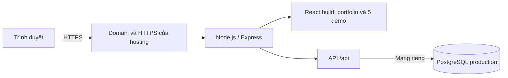
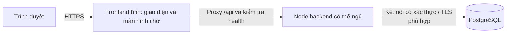

# Kế hoạch deploy project-codex

Ngày2026-10-09. Đây là kế hoạch đưa portfolio và năm demo lên website công khai. Chưa sửa runtime, tạo tài nguyên trả phí, đổi DNS hoặc deploy. Checklist duy nhất: mục Deploy trong [PORTFOLIO_TASKS.md](../PORTFOLIO_TASKS.md). Prompt thực hiện: [RUN_DEPLOY_TASKS.md](../RUN_DEPLOY_TASKS.md).

Lựa chọn hiện tại của người dùng: **chỉ xem kế hoạch trước, chưa chọn nhà cung cấp**. D01 chưa chốt; Railway dưới đây là phương án tham khảo, không được tự chọn để triển khai.

## Kiến trúc đề xuất

Kiến trúc đề xuất: **một service Node.js và một PostgreSQL**, có thể dùng hosting quản lý sẵn hoặc VPS. Express phục vụ React build và `/api` chung origin; giữ cấu trúc monorepo và cookie admin hiện tại. Nếu chọn Railway, database cần cấu hình volume/backup và kiểm tra restore; không coi việc thêm service PostgreSQL là đã hoàn tất vận hành DB.



Có một môi trường staging riêng để thử cập nhật; staging/prod không dùng chung DB hoặc secret. Bản đầu chạy một instance app, chưa cần Kubernetes, Redis hay CDN riêng. Nếu sau này tăng nhiều instance, thay rate limiter trong bộ nhớ bằng storage dùng chung trước khi scale.

### Nhánh có màn hình chờ khi backend ngủ

Yêu cầu bổ sung ngày2026-10-09: giao diện thông báo trong lúc dịch vụ khởi động và tự mở website khi sẵn sàng. Đây là thiết kế bổ sung, chưa triển khai và không chốt nhà cung cấp.

Để màn hình chờ xuất hiện ngay, **React/HTML/CSS phải được phục vụ từ hosting tĩnh/CDN độc lập với Node.js đang ngủ**. Nếu toàn bộ HTML vẫn do Express trên Render Free phục vụ, người truy cập đầu tiên có thể thấy trang chờ của Render trước khi JavaScript của project chạy; thêm loading component vào app không giải quyết được giai đoạn đó.

Ví dụ phương án tham khảo: frontend tĩnh trên Netlify/Vercel, backend Node trên Render Free, PostgreSQL trên Neon Free. D01 kiểm tra hạn mức và hỗ trợ proxy của nền tảng được chọn; không mặc định chọn bộ dịch vụ này. Giữ một origin public bằng rewrite/proxy `/api/*` từ frontend đến backend, còn route trang trả SPA tĩnh. Cookie/Origin/CSRF tiếp tục theo origin frontend; không đổi API sang fetch cross-origin mà chưa xử lý auth.



Hành vi dự kiến:

1. Frontend tải ngay. Lúc kết nối ban đầu, hiển thị **“Đang kết nối dịch vụ. Lần truy cập đầu có thể cần khoảng một phút.”** cùng trạng thái chờ/thời gian đã chờ. Không khẳng định chắc chắn server ngủ vì lỗi mạng hoặc DB cũng có thể khiến health chưa sẵn sàng; không dùng phần trăm tiến độ giả.
2. Gọi `GET /api/health` với timeout tối đa8 giây/request, `cache: no-store`; API/proxy không cache response. Chỉ coi sẵn sàng khi HTTP200, JSON hợp lệ và `data.status === 'ok'`. Trang loading HTML200 của hosting không được xem là thành công.
3. Khi chưa sẵn sàng, thử tiếp sau khoảng5 giây sau khi request trước kết thúc, thêm jitter để nhiều tab không gọi đồng loạt; tổng phiên tự chờ tối đa120 giây. Không có request health chồng nhau. Dừng timer/abort khi unmount, quá hạn hoặc chuyển offline; xử lý quay lại online/foreground bằng kiểm tra lại có giới hạn.
4. Khi health đạt, tự bỏ màn hình chờ và mở đúng pathname/query/hash đang truy cập; tải lại các query đọc cần thiết. Người dùng không cần bấm F5. Ưu tiên chuyển state/refetch thay reload toàn trang để giữ nháp, form và history; không tự replay POST/PATCH/DELETE. Nếu chọn full reload cho bootstrap, chỉ một lần trước khi người dùng nhập liệu, không lặp reload khi lỗi.
5. Quá120 giây chuyển sang **“Chưa kết nối được dịch vụ. Bạn có thể thử lại.”**, nút **Thử lại** khởi động một lượt chờ mới. Offline hiển thị lỗi kết nối mạng phù hợp. Trong khi người dùng đã ở app, lỗi API hiển thị banner/trạng thái lỗi và giữ màn hình/form/nháp đang làm; không unmount editor hoặc hard reload tự động.

Màn hình có `role=status`/aria-live phù hợp, nút retry dùng bàn phím, hỗ trợ reduced motion và360/768/1440px. `/api/health` vẫn kiểm tra DB thật, vì Node mở cổng chưa đủ chứng minh ứng dụng dùng được. Poll chỉ diễn ra khi có người đang truy cập/chờ; không tạo job nền để giữ hosting miễn phí luôn thức.

Phần triển khai gắn vào D03 (proxy/auth/health), D06 (frontend static/rewrite), D07 (bootstrap/poll/recovery và test), D10 (nghiệm thu trên HTTPS), D12 (origin/domain). File dự kiến: `apps/web/src/components/service-readiness.tsx`, hook trạng thái kết nối và config hosting tĩnh theo D01. Test bắt buộc: ready ngay,503→ready, response HTML200, timeout/offline/quá hạn, cleanup/no overlap/no reload loop; giữ deep link và nháp/form khi mất API; auth và lưu snapshot qua proxy. Tất cả hiện là tiêu chí chưa chạy.

| Đường dẫn public                                                        | Nội dung                                           |
| ----------------------------------------------------------------------- | -------------------------------------------------- |
| `/`                                                                     | Portfolio và5 card từ DB                           |
| `/projects/autohub`                                                     | Xe, chi tiết, so sánh, yêu cầu tư vấn/lái thử      |
| `/projects/memory-match`                                                | Game và leaderboard                                |
| `/projects/admin`                                                       | Đăng nhập và quản trị                              |
| `/projects/room-studio`                                                 | Room Studio; alias `/projects/rooms` giữ hoạt động |
| `/projects/brick-playground`                                            | Brick Playground                                   |
| `/projects/room-studio/view/:id`, `/projects/brick-playground/view/:id` | Snapshot chỉ đọc/chia sẻ                           |

Nếu chọn hosting có domain mặc định như Railway, domain đó đủ cho lần đầu; tên miền riêng là bước tùy chọn. Khi có tên miền riêng, chọn một origin chính và redirect domain phụ về đó, giữ path/query. `WEB_ORIGIN` chỉ chứa origin HTTPS chính để các thao tác ghi không bị403.

## Chi phí và lựa chọn

| Phương án                  | Phù hợp                                                  | Đổi lại                                                     |
| -------------------------- | -------------------------------------------------------- | ----------------------------------------------------------- |
| Railway — đề xuất          | Portfolio fullstack, triển khai GitHub/Docker, HTTPS sẵn | Trả theo tài nguyên; cần chủ động backup/giới hạn chi phí   |
| VPS + Docker + Caddy/Nginx | Muốn tự quản hoặc đã có VPS                              | Tự vận hành OS, chứng chỉ, firewall, DB, backup và cập nhật |

Dự trù **10–20USD/tháng** cho app+DB là ước tính tham khảo của phương án Railway, chưa phải ngân sách đã chốt, chưa gồm domain và có thể tăng theo backup/egress/tài nguyên. Staging luôn bật tính thêm chi phí. Tài liệu Railway tại thời điểm đọc ghi Hobby5USD/tháng; đây không phải cam kết tổng app+DB chỉ5USD. D01 phải đối chiếu giá/billing của nhà cung cấp được chọn và chốt ngân sách trước khi tạo tài nguyên. Có thể chỉ bật staging trong đợt kiểm thử để giảm phí, vẫn giữ DB tách biệt.

## Những điểm cần sửa từ mã hiện tại

| File/hành vi đã đối chiếu                                      | Ảnh hưởng                                                  | Việc cần làm                                                                                              |
| -------------------------------------------------------------- | ---------------------------------------------------------- | --------------------------------------------------------------------------------------------------------- |
| `apps/api/src/server.ts` bind `127.0.0.1`                      | Ingress container không gọi được app                       | `HOST` có kiểm tra; dev giữ loopback, container dùng `0.0.0.0` và `PORT` của hosting                      |
| `apps/api/src/config.ts` chỉ chấp nhận DB dev/test             | DB mới do hosting cấp có thể bị từ chối                    | Cho phép DB production đã khai báo rõ, kiểm tra tên/URL; giữ guard DB test                                |
| `TRUST_PROXY` chỉ hỗ trợ loopback                              | Cookie Secure/IP limiter có thể sai sau edge proxy         | Cấu hình trust phù hợp topology thực, kiểm tra HTTPS/IP và header giả mạo; không bật tin mọi proxy        |
| `apps/api/src/db.ts` chỉ có connection string/timeout          | Chưa chốt TLS và giới hạn kết nối production               | Mạng riêng, auth, TLS theo provider và pool giới hạn phù hợp; không tắt kiểm chứng certificate để hết lỗi |
| Build/seed/bootstrap có script source dùng `tsx`               | Runtime chỉ có dependency production không chạy được `tsx` | Dùng compiled `dist/scripts/*.js` cho thao tác release                                                    |
| `scripts/smoke.mjs` chỉ cho localhost và tự dọn fixture qua DB | Không phù hợp kiểm tra website public                      | Giữ script local; thêm smoke deploy mặc định chỉ đọc, không lấy DB production để chạy test                |
| Chưa có Dockerfile/CI/deploy manifest                          | Chưa có cách build/release lặp lại                         | Container đa stage, healthcheck, CI và cấu hình hosting có version                                        |

Express đã có SPA fallback, API/asset404 và startup migration có checksum/lock/transaction; giữ các hành vi này. Migration001–004 không sửa. Nghiệm thu PJ5 trước đó đạt38 API+15 web+37 E2E vào2026-10-08; đây là baseline, không phải bằng chứng đã chạy trên production.

## Cấu hình đích

| Biến                            | Vai trò                                                                                              |
| ------------------------------- | ---------------------------------------------------------------------------------------------------- |
| `NODE_ENV=production`           | Cookie Secure và hành vi production                                                                  |
| `HOST=0.0.0.0`                  | Listener trong container, sau D03                                                                    |
| `PORT`                          | Hosting cấp; không hardcode5173/4100 trong production                                                |
| `DATABASE_URL`                  | Secret kết nối tới đúng PostgreSQL của môi trường                                                    |
| `EXPECTED_DATABASE_NAME`        | Biến dự kiến sau D02: tên DB phải khớp URL, kể cả tên mặc định provider; dev/test vẫn có guard riêng |
| `WEB_ORIGIN`                    | Origin HTTPS chính, không có path/dấu `/` cuối                                                       |
| `SESSION_SECRET`                | Secret ngẫu nhiên riêng mỗi môi trường, ổn định qua restart                                          |
| `TRUST_PROXY`                   | Giá trị được kiểm tra theo topology/provider sau D03                                                 |
| `ADMIN_EMAIL`, `ADMIN_PASSWORD` | Chỉ cấp cho job bootstrap một lần; không đưa vào React hoặc log                                      |

Không cấp `TEST_DATABASE_URL` vào app production. CI/test có DB và secret riêng. Domain/PORT là cấu hình thường; connection URL/session/password dùng secret manager của hosting. Thay session secret sẽ làm mất hiệu lực session đang có, nên không tạo lại mỗi deploy.

Các lệnh runtime dự kiến dùng sau build, cần được D05/D06 thử thật trong image:

```bash
node apps/api/dist/scripts/migrate.js
node apps/api/dist/scripts/seed.js
node apps/api/dist/scripts/bootstrap.js
node apps/api/dist/server.js
```

Seed và bootstrap là thao tác khởi tạo có kiểm tra một lần, không gắn vào mỗi request/restart. Seed hiện thêm5 card/12 xe minh họa và giữ dữ liệu đã chỉnh. API vẫn migrate trước listen như hiện tại; release job có thể migrate trước để phát hiện lỗi sớm, cùng runner idempotent. Build không kết nối DB production. Mọi migration tương lai phải tương thích với phiên bản app đang chạy trong thời gian đổi release.

## Task triển khai D01–D14

### D01 — Chốt hosting, phạm vi và ngân sách

- Phụ thuộc: không.
- Khi được giao triển khai, chốt nhà cung cấp (Railway, VPS hoặc phương án khác), staging/prod, vùng đặt app/DB, ngân sách, domain mặc định/custom và dữ liệu khởi tạo. Chốt kiến trúc Express phục vụ tất cả hoặc frontend tĩnh/proxy độc lập nếu muốn màn hình chờ khi BE ngủ. Dùng repo `hoamiz/project-codex`, branch `main`; quyền GitHub không tự cấp quyền hosting/DNS.
- Kết quả: ghi cấu hình đích, tài nguyên, chi phí dự trù và quyền còn thiếu; chưa tạo dịch vụ trả phí trong task lập kế hoạch.
- Kiểm tra: tài liệu provider/tài khoản hiện tại, repo/ref đúng, không ghi credential. Nếu thiếu quyền hosting, tiếp tục phần code đủ thông tin và quay lại phần tài nguyên sau.

### D02 — Cấu hình production có kiểm tra

- Phụ thuộc: D01.
- File: `apps/api/src/config.ts`, `.env.example`, tài liệu; thêm test cấu hình cần thiết.
- Validate HOST/PORT/origin/session secret và `EXPECTED_DATABASE_NAME` theo môi trường. DB production phải thuộc service đã chọn; không bỏ guard để dùng tùy ý DB. Giữ `project_codex_test` trong runner, không cho unit/API/E2E chạy vào prod.
- Hoàn thành/kiểm tra: config dev cũ vẫn dùng được; tên DB/origin/PORT sai bị từ chối; production không âm thầm dùng localhost/secret thiếu; test negative cases và typecheck đạt. Biến dự kiến chỉ được coi là tồn tại sau khi code/test xong.

### D03 — Listener, proxy và cookie HTTPS

- Phụ thuộc: D02.
- File: `server.ts`, `app.ts`, auth/config và compiled verification khi cần.
- Listener hỗ trợ container; xác minh headers/topology edge của provider, cấu hình trust giới hạn. Kiểm tra IP dùng cho limiter và Secure cookie sau HTTPS termination. Với frontend tĩnh, kiểm tra cả đường qua proxy frontend và URL backend trực tiếp, giữ Origin/cookie/CSRF/method/body; health không cache. Giữ shutdown có SIGTERM/timeout hữu hạn để release không treo khi còn kết nối.
- Hoàn thành/kiểm tra: app gọi được từ ngoài container; login/me/logout qua HTTPS có HttpOnly/Secure/SameSite; thiếu Origin/CSRF vẫn bị từ chối; không tin header client trên đường không qua proxy tin cậy. Bài test proxy/dev/compiled tương ứng đạt.

### D04 — Kết nối PostgreSQL production

- Phụ thuộc: D02.
- File: `db.ts`/config và hướng dẫn DB.
- Chốt private connection URL khi nhà cung cấp hỗ trợ; với DB khác nền tảng như Neon, dùng endpoint có xác thực/TLS theo tài liệu provider. Chốt pool max/timeout và giới hạn tổng connection cho app/job. Không dùng trust auth phát triển cho production. Health vẫn query DB thật.
- Hoàn thành/kiểm tra: DB có auth và đúng environment; TLS theo cấu hình hỗ trợ, lỗi certificate không bị bỏ qua; DB mất kết nối trả trạng thái/lỗi an toàn. Thử trước với DB cô lập, sau đó staging ở D09/D10.

### D05 — Migration, seed và admin trong bản build

- Phụ thuộc: D02,D04.
- File: compiled scripts hiện có, release hướng dẫn/config; chỉ thêm script nếu cần.
- Chạy migration001–004 trên DB staging mới, seed5 card/12 xe, bootstrap admin bằng secret riêng. Các lần chạy lại giữ metadata/password đã có. Tài khoản production do chủ website dùng, không lấy `.env` dev.
- Hoàn thành/kiểm tra: image không cần `tsx`; chạy lại không trùng/xóa row; snapshot/lead/session được bảo toàn; lỗi migration chặn startup; bootstrap không in mật khẩu. Không đánh dấu bằng việc chỉ có lệnh trong tài liệu.

### D06 — Docker image và cấu hình hosting

- Phụ thuộc: D03–D05.
- File dự kiến: `Dockerfile`, `.dockerignore`, cấu hình Railway hoặc Compose tương ứng D01.
- Đa stage Node24: frozen `npm ci` → FE/API build → runtime dependency production. Runtime giữ `apps/api/dist`, `apps/api/db/migrations`, `apps/web/dist` và package/workspace cần thiết; dùng user không phải root. `.env`, `.local`, database, node_modules host và artifact test bị loại khỏi build context.
- Nếu chọn màn hình chờ khi BE ngủ, deploy `apps/web/dist` độc lập lên static hosting và cấu hình rewrite `/api/*` trước SPA fallback; giữ deep links, asset404, HTTPS và cookie cùng origin. Node image vẫn phục vụ API và bản build theo cấu hình; frontend public không phụ thuộc Node để tải HTML/JS màn hình chờ.
- Hoàn thành/kiểm tra: build clean thành công, image khởi động bằng secret inject và DB cô lập, served React/assets/SPA/API hoạt động. Health path `/api/health`; timeout startup đủ cho migration. Kiểm tra tài nguyên/cache/compression từ hosting và ghi kích thước bundle, không tắt cảnh báo để nghiệm thu.

### D07 — Smoke dành cho website đã deploy

- Phụ thuộc: D06.
- File dự kiến: `scripts/smoke-deploy.mjs` và bài test cần thiết. Giữ smoke local hiện có.
- Nhận base URL rõ ràng; mặc định chỉ đọc: health/5 card/catalog/demos/direct reload/alias/asset404/admin401. Mở snapshot mẫu đã có để kiểm tra viewer. Không dùng script local vượt guard, xóa dữ liệu production hay chạy full suite vào prod.
- Nếu chọn nhánh frontend tĩnh, xây màn hình chờ và readiness controller theo hợp đồng ở trên; chỉ polling health/read query, không replay mutations. Test ready/503/HTML200/timeout/offline/quá hạn, timer cleanup/no overlap, giữ URL/form/draft và tự vào app đúng lúc sẵn sàng.
- Hoàn thành/kiểm tra: smoke có thể phát hiện DB/route/render lỗi, HTTPS/origin sai và trả exit code khôngzero; không cần đọc DB trực tiếp/credential để kiểm tra public. Chạy với image ở môi trường cô lập; mutation tests dành cho staging có fixture riêng.

### D08 — CI và release theo commit

- Phụ thuộc: D06,D07.
- File dự kiến: `.github/workflows/ci.yml` và manifest release.
- CI Node24 + PostgreSQL test + Chromium: frozen install, `npm run check`, format, container build. Dùng DB test/secret tạm riêng; không gọi `npm run setup` để tạo DB dev trong job production. Artifact auth không chứa password/cookie.
- Hoàn thành/kiểm tra: PR lỗi bị chặn, commit đạt có CI xanh; chọn chính xác SHA/image để staging/prod. Đợt đầu deploy thủ công sau CI đạt; không bật production auto-deploy trước nghiệm thu staging. Nếu bật về sau, bắt buộc chờ check bắt buộc.

### D09 — Tạo staging và kết nối GitHub

- Phụ thuộc: D08 và quyền hosting/billing đã có.
- Tạo app/DB staging, inject biến/secret, config private networking/volume/health/domain mặc định. Deploy commit đã đạt CI, khởi tạo bằng D05.
- Hoàn thành/kiểm tra: URL HTTPS staging public và health200/DB thật;5 card và12 xe mẫu; route trực tiếp/reload không404. Đối chiếu release SHA và DB riêng. Cần tài khoản hosting/khả năng cấp tài nguyên thật, không suy ra từ quyền GitHub.

### D10 — Nghiệm thu staging đầy đủ

- Phụ thuộc: D09.
- Kiểm tra năm demo qua HTTPS: lead/game/admin CRUD, Secure cookie, CSRF/origin; Room/Brick drag/camera/PNG/draft/save/retry/viewer/copy; mobile360/768/1440, fallback2D và URL alias.
- Với nhánh miễn phí có BE ngủ, nghiệm thu first visit sau idle qua frontend tĩnh: thấy giao diện chờ của project, health xác minh cả DB, tự chuyển sang app đúng deep link. Phân biệt test response chậm có kiểm soát với cold start thật; không tuyên bố đã thử server ngủ nếu chỉ mock API.
- Hoàn thành/kiểm tra: kiểm tra DB staging xác nhận snapshot còn sau redeploy/restart; nháp chỉ ở trình duyệt và không chuyển thành DB ngoài lệnh save. Auth/DB cô lập, fixture theo ID, không reset DB dùng chung. Ghi thời gian tải/lazy3D và lỗi thực; baseline90 test cũ không thay được bước này.

### D11 — Backup, restore và rollback

- Phụ thuộc: D10.
- Cấu hình backup DB/volume theo gói hỗ trợ, dự kiến hằng ngày và retention tối thiểu7 ngày; thêm bản logical export ngoài cùng service nếu phù hợp. Định nghĩa mục tiêu RPO24h/RTO2h cho portfolio, đây là mục tiêu cần thử chứ không phải SLA.
- Hoàn thành/kiểm tra: restore vào DB mới/cô lập, kiểm tra5 card/xe/lead/snapshot và metadata/checksum; ghi thời gian phục hồi thực. Diễn tập quay app về image/SHA trước mà không mất DB. Không tự down migration/khôi phục đè DB live; migration không tương thích phải có phương án xử lý riêng.

### D12 — Domain chính và HTTPS

- Phụ thuộc: D10 và quyền DNS nếu dùng domain riêng.
- Chọn domain hosting hoặc custom, TLS, origin chính và redirect hostname phụ giữ path/query; xác minh cấu hình proxy từ D03 trên đường truy cập thật. Tên miền riêng có thể làm sau mà không chặn ra mắt bằng domain hosting nếu nhà cung cấp hỗ trợ.
- Hoàn thành/kiểm tra: certificate hợp lệ, HTTP→HTTPS, domain chính ổn định, route viewer/deep link giữ URL; admin/save không403 do Origin. Đổi domain không tự chuyển nháp localStorage từ origin cũ: cần thông báo hoặc cho người dùng lưu/chia sẻ trước.

### D13 — Release production

- Phụ thuộc: D10–D12; đã được người dùng giao thực hiện deploy, hosting/billing và origin đích rõ ràng.
- Tạo app/DB production độc lập, backup hoạt động, inject secret đúng env và deploy cùng commit/image đã nghiệm thu. Seed demo/admin chỉ đúng phạm vi đã chốt D01. Public một URL website chính.
- Hoàn thành/kiểm tra: smoke đọc D07 đạt trên URL thật;5 card/direct/reload/HTTPS/auth đúng. Ghi nhận snapshot mẫu production nếu đã chốt, không tạo khách hàng giả. Nếu lỗi, giữ dữ liệu và rollback app theo D11; chưa đủ nghiệm thu thì ghi chưa xong.

### D14 — Vận hành và tài liệu bàn giao

- Phụ thuộc: D13.
- Log không có secret/PII đầy đủ, uptime health/latency/error, DB connection/disk, CPU/RAM/egress/budget và backup alerts. Bản đầu limiter một process có thể reset khi restart; ghi hạn chế và cách scale. Xem xét cleanup session/game hết hạn theo batch mà giữ kết quả/snapshot/lead.
- Hoàn thành/kiểm tra: restart không mất dữ liệu, có backup gần nhất/restore evidence, rollback chỉ tới commit đã kiểm tra. README/verification/checklist ghi URL, release SHA, lệnh thao tác, kết quả/fail/skip và người quản lý. Bàn giao tài khoản qua secret manager; không gửi password trong chat hoặc Git.

## Thứ tự và điều kiện hoàn tất

Luồng mặc định D01→D14; D03/D04 cùng dựa D02 và D11/D12 cùng dựa D10. Đây là phụ thuộc công việc, không yêu cầu nhiều agent. Nếu thiếu tài khoản/domain, hoàn thành code/config/checks độc lập rồi ghi blocker cho đúng bước tài nguyên; không đánh dấu task public đã xong.

Hoàn tất khi có URL HTTPS public, năm demo và DB production hoạt động, CI/release lặp lại được, backup đã restore thử, rollback có bằng chứng và nhật ký đúng commit. Publish snapshot môi trường Codex là việc lưu môi trường phát triển để tái sử dụng; nó không thay thế deploy website public này.

## Nguồn và xác minh kế hoạch

Đã đối chiếu config/server/db/auth, manifests, compiled migration/seed/bootstrap và smoke của repo ở commit `ec257c6`. Tài liệu provider đọc ngày2026-10-09; D01/D03 phải kiểm tra lại chi tiết phù hợp tài khoản/topology khi thực hiện:

- [Railway plans/pricing](https://docs.railway.com/reference/pricing/plans).
- [Deploy Express](https://docs.railway.com/guides/express).
- [Public networking/domain/HTTPS](https://docs.railway.com/guides/public-networking).
- [PostgreSQL](https://docs.railway.com/guides/postgresql).
- [Backups](https://docs.railway.com/reference/backups).

Thay đổi lượt này chỉ là kế hoạch/tài liệu. Không chạy lại test ứng dụng hoặc tự thay cấu hình cloud vì runtime không đổi. Kiểm tra links, checklist/phụ thuộc, code fence, format file mới và diff trước khi bàn giao.
