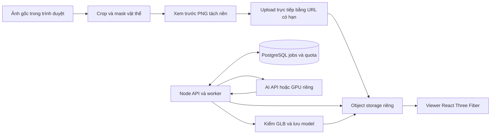

# PJ7 — Scan Studio 3D

Kế hoạch ngày 2026-10-14 cho project-codex; **chưa triển khai ứng dụng**. Checklist S01–S24 nằm tại [PORTFOLIO_TASKS.md](../PORTFOLIO_TASKS.md), prompt thực hiện tại [RUN_PJ7_TASKS.md](../RUN_PJ7_TASKS.md). Đọc cùng [AGENTS.md](../AGENTS.md).

## 1. Mục tiêu và MVP đề xuất

PJ7 tạo model 3D từ ảnh và **chỉ tập trung vào vật thể chính trong ảnh**, theo yêu cầu của người dùng. MVP đề xuất dùng một ảnh: chọn vật thể, tách nền, gửi phần ảnh đã chuẩn bị cho AI, xem model có texture và tải GLB. AI suy đoán phần khuất; kết quả không cam kết kích thước thật hoặc độ chính xác để chế tạo.

- Tên: **Scan Studio 3D**; slug: scan-studio; thêm card thứ bảy vào portfolio.
- Studio: /projects/scan-studio.
- Job riêng của người tạo: /projects/scan-studio/jobs/:id.
- Link chia sẻ chỉ đọc: /projects/scan-studio/view/:token.
- Luồng: **Tải ảnh → Chọn vật thể → Tách nền/xem trước → Tạo model 3D → Xem/xuất GLB**.
- Mỗi job dựng một vật thể. Ảnh gốc giữ trong trình duyệt; chỉ PNG của vật thể đã chọn được gửi lên.

| Hướng                   | Kết quả                                           | Phạm vi       |
| ----------------------- | ------------------------------------------------- | ------------- |
| Một ảnh + AI            | Tạo mesh và texture, suy đoán phần khuất          | MVP đề xuất   |
| Nhiều ảnh quanh vật thể | Photogrammetry từ ảnh chồng lấp và nhiều góc nhìn | Phiên bản sau |

MVP chưa bao gồm dựng cả căn phòng, AR, multiplayer, sửa topology hoặc nhập model vào Room Studio. Model phải có hình học 3D để xoay xem; ảnh phẳng hoặc relief không được coi là bằng chứng dựng model bằng AI.

## 2. Giao diện và chọn vật thể chính

Desktop có bảng chọn ảnh/vật thể bên trái, khung xem 3D bên phải và trạng thái xử lý phía dưới. Mobile dùng tab **Ảnh / Model**, nút lớn và tiến trình theo bước. Giao diện sáng, nền studio trung tính, điểm nhấn xanh.

1. Nhận JPG, PNG và WebP, tối đa 10 MiB và 20 megapixel. Có chọn file, kéo thả và chụp ảnh trên thiết bị hỗ trợ khi người dùng chủ động chọn. HEIC chưa hỗ trợ; thông báo cần đổi định dạng.
2. Hiển thị ảnh đúng hướng. Giữ ảnh gốc trong phiên trình duyệt, không ghi vào localStorage hoặc tự upload ngay khi chọn.
3. Chọn vùng bao vật thể; có chỉnh crop, dịch chuyển bằng bàn phím và đặt lại.
4. **Tách vật thể bằng mask là bước bắt buộc**. Nhận PNG đã có nền trong suốt; ảnh thường có công cụ khoanh đường viền hoặc tô vùng giữ/xóa, hoàn tác và đặt lại. Xem trước trên nền caro/nền trắng. Tách nền tự động là tùy chọn nếu S02 xác minh được công cụ, giấy phép và tài nguyên phù hợp.
5. Xuất PNG RGBA có nền trong suốt, padding nhỏ, cạnh dài mục tiêu 1024 px, tối đa 2048 px và 4 MiB. Từ chối mask rỗng hoặc vật thể quá nhỏ. Một crop hình chữ nhật còn nguyên đồ vật khác chưa đáp ứng yêu cầu tách vật thể.
6. Bấm **Dùng vật thể này** để xác nhận ảnh chuẩn bị, rồi **Tạo model 3D** mới upload và đăng ký job. Đổi ảnh hoặc vùng chọn không tự sửa job cũ hay tạo job mới.
7. AI chỉ nhận PNG đã chuẩn bị. Hướng dẫn chọn vật thể đầy đủ, đủ sáng, ít che khuất; thông báo hạn chế với vật trong suốt, phản chiếu hoặc bị che nhiều.

Viewer có xoay, kéo, zoom, đặt lại camera, căn vừa model, đổi nền, lưới và texture/wireframe. Lazy-load Three/Fiber/Drei và render theo nhu cầu. Camera chỉ đổi cách xem; GLB tải xuống giữ nguyên model của job. Nếu WebGL không hoạt động, vẫn hiện thumbnail, thông tin và nút tải.

## 3. Chế độ sử dụng và chi phí

- **Model mẫu**: khách xem model tự host có nguồn và giấy phép rõ. Ghi nhãn mẫu; không nhận ảnh rồi trình bày model mẫu như kết quả dựng từ ảnh đó.
- **Tạo từ ảnh**: MVP đề xuất tái dùng session admin hiện có cho người tạo để quản lý tài nguyên. Đăng nhập giữ ảnh/vùng chọn và không tự gửi job. Khách xem link chia sẻ khi chủ model bật quyền chia sẻ.

Số job AI thật mỗi ngày và ngân sách mặc định bằng **0** cho đến khi có provider, tài khoản và quota đã xác minh. Khi bật, giới hạn theo người tạo, IP và toàn website; xử lý đồng thời ban đầu một job. Không tự mua credit, thêm thẻ hoặc nâng gói. Các lựa chọn này cần chốt tại S02 khi triển khai.

Đề xuất **Meshy Image-to-3D API** cho MVP; Tripo là ứng viên thay thế sau khi kiểm tra hợp đồng. **TRELLIS.2** trên GPU riêng là hướng tự host, cần thử phần cứng, weights, dependencies và giấy phép. Render Free chạy Node API trên CPU; không phù hợp để chạy mô hình dựng 3D nặng.

Hosting FE/BE/DB miễn phí không đồng nghĩa AI dựng model miễn phí. Giá/job, trial credit, quota, hạn lưu kết quả và quyền sử dụng output cần được kiểm tra từ tài khoản thật trước khi gọi AI; chưa cam kết giá hoặc số lượt miễn phí.

## 4. Kiến trúc và lưu trữ

- React/TS/Tailwind dùng renderer 3D hiện có; Node/Express điều phối xử lý; PostgreSQL lưu metadata, trạng thái và quota. Không lưu ảnh/GLB binary trong DB.
- Object storage riêng, tương thích S3 là ứng viên, ví dụ R2. S02 xác minh quota, credential, CORS và upload/download có chữ ký. Kiểm thử local bằng storage riêng, ví dụ MinIO nếu chọn S3. Không lưu model lâu dài trên filesystem tạm của Render.
- Vercel gateway và Express hiện giới hạn body JSON **32 KB**: giữ giới hạn. Ảnh/model truyền trực tiếp tới storage; API chỉ nhận JSON nhỏ và cấp URL/header có hạn. Không chuyển ảnh base64 hoặc GLB qua gateway.
- Bucket private, server tạo object key UUID. Ticket upload có hạn 5 phút, gắn người tạo, job, format, size và hash. Kiểm HEAD và bytes thật trước gọi AI; xóa object không hợp lệ. S02 phải kiểm khả năng áp giới hạn upload của storage, không chỉ tin khai báo từ client.
- Prepared PNG giữ tối đa 24 giờ; GLB/thumbnail giữ 7 ngày theo đề xuất. Chia sẻ không kéo dài thời hạn. Có cleanup có thể chạy lại, quota storage và trạng thái expired. S01 xác nhận chính sách trước triển khai.
- URL model cho trình duyệt mặc định 5 phút, được cấp lại sau kiểm quyền. URL input cho AI được tạo mới khi dispatch, dự kiến 60 phút; S02 phải kiểm thời gian provider lấy ảnh. Không dùng URL đã hết hạn sau khi job chờ hoặc server thức lại.
- Tải, kiểm và lưu output của provider vào storage của dự án; không dùng URL output có hạn làm địa chỉ model lâu dài.
- API key và storage secret chỉ ở server, không đưa vào VITE, FE hoặc log. Chỉ gọi HTTPS tới hostname đã xác minh; không nhận URL ảnh tùy ý hoặc tự fetch redirect sang host khác.

## 5. Jobs, khả năng khôi phục và ngân sách

Trạng thái dự kiến: awaiting_upload → validating → queued → submitting → processing → importing → succeeded; nhánh submission_unknown, failed và expired. Trạng thái kết thúc không quay lại processing; xem trước, đặt lại hoặc reload không tạo lượt AI mới.

Bảng scan_jobs lưu UUID, owner liên kết admin_users, trạng thái/version, input key/hash, preparedImageKey, imageDigest, provider/providerTaskId, tiến trình thật nếu có, deadline/nextPoll/lease, model key/digest/metrics, mã lỗi an toàn và timestamps. Bảng scan_shares lưu hash token ngẫu nhiên ít nhất 128 bit, jobId, expiry và revokedAt. Có bảng giữ chỗ quota để giới hạn đúng khi nhiều request đồng thời.

- Migration dự kiến **apps/api/db/migrations/006_scan_studio.sql**, giữ 001–005. Thêm card bằng ON CONFLICT và cập nhật seed mà bảo toàn metadata đã chỉnh. DB có sáu project phải nâng cấp được mà không reset hoặc bắt chạy lại seed.
- POST tạo job dùng UUID Idempotency-Key và hash input/params. Cùng key/cùng payload trả job cũ; cùng key/khác payload trả 409. Reload hoặc retry đọc trạng thái không gửi lại lệnh tạo.
- Giữ chỗ quota/ngân sách trước dispatch. Không giữ transaction DB mở trong lúc gọi provider. Giải phóng/đối chiếu theo kết quả thực; lỗi mạng chưa chứng minh không bị tính credit.
- Provider có thể không hỗ trợ idempotency: S02/S08 kiểm hợp đồng. Nếu timeout sau khi gửi và chưa biết provider đã nhận, lưu **submission_unknown** rồi đối chiếu; không tự gửi lại POST. Key nội bộ không bảo đảm provider chỉ nhận một lần. Nếu không có cách đối chiếu đáng tin cậy, job cần người vận hành xử lý.
- Worker chỉ gửi task, poll và nhập output. Dùng lease và **FOR UPDATE SKIP LOCKED**, tiếp quản khi lease hết; lưu lịch xử lý trong DB, có backoff/jitter và giới hạn đồng thời. Queue chỉ trong bộ nhớ không đáp ứng yêu cầu khôi phục.
- Giá trị ban đầu để thử: HTTP timeout 15 giây, lease 120 giây với heartbeat khi import, poll 5–30 giây, deadline mềm 30 phút. Deadline không chứng minh GPU đã hủy hoặc credit đã hoàn; không tự tạo job thay thế.
- Render Free ngủ/restart làm worker tạm dừng. Provider tiếp tục task đã nhận; API khởi động lại hoặc đọc trạng thái sẽ khôi phục scheduler và đối chiếu. S02 kiểm thời hạn task/output và cách cấp lại URL; không hứa worker hoạt động liên tục khi server ngủ.
- FE poll có abort, xử lý offline/tab ẩn, backoff và thời hạn. Route chứa jobId để khôi phục sau reload. Chỉ gửi lại request đọc, không tự phát lại POST. Hiện giai đoạn hoặc phần trăm thật từ provider.

## 6. API đề xuất

Request thay đổi dữ liệu cần session, Origin và CSRF; kiểm quyền theo owner. API công khai không lộ secret hoặc provider task ID. Dùng quy ước HTTP/error hiện có.

| Endpoint                         | Mục đích                        | Quyền/kết quả                                              |
| -------------------------------- | ------------------------------- | ---------------------------------------------------------- |
| GET /api/scans/capabilities      | Giới hạn và chế độ mẫu/live     | Public, không lộ credential                                |
| POST /api/scans/uploads          | Slot và ticket upload PNG       | Owner; JSON format/size/digest, URL tạm                    |
| POST /api/scans/jobs             | Xác minh slot và đăng ký job    | Owner + UUID key; 202 mới, 200 retry, 409 xung đột         |
| GET /api/scans/jobs/:id          | Trạng thái, tiến trình, preview | Owner; 404 khi không có hoặc không được quyền              |
| GET /api/scans/jobs              | Lịch sử phân trang              | Owner                                                      |
| GET /api/scans/jobs/:id/model    | Cấp URL tải GLB                 | Owner; chỉ succeeded và chưa expired                       |
| POST /api/scans/jobs/:id/share   | Bật chia sẻ                     | Owner, không nhân bản token khi retry                      |
| DELETE /api/scans/jobs/:id/share | Thu hồi chia sẻ                 | Owner, có thể gọi lại                                      |
| GET /api/scans/shared/:token     | Model qua link chỉ đọc          | Public; không lộ ảnh gốc, owner hoặc provider ID           |
| DELETE /api/scans/jobs/:id       | Xóa metadata/model              | Owner; chỉ job đã kết thúc, không coi là hủy GPU đang chạy |

**Prepared PNG**: bytes thật ≤4 MiB, mỗi cạnh 256–2048 px, decode có giới hạn và mask không rỗng; server bỏ metadata/chuẩn hóa PNG. Nếu server chuẩn hóa, hash gửi cho provider phải ghi theo ảnh thực tế sau chuẩn hóa.

**GLB**: v2, tự chứa tài nguyên, ≤25 MiB, ≤100.000 tam giác, ≤4 texture, mỗi texture tối đa 2048 px; không có URI bên ngoài. Import có giới hạn thời gian/bộ nhớ. S02 kiểm format/compression thật; S11 chuẩn hóa hoặc báo lỗi rõ khi output vượt giới hạn. Decoder cần tự host và có giấy phép phù hợp.

## 7. Task nhỏ để Codex triển khai

Mỗi task có phụ thuộc và kiểm tra để đánh dấu hoàn thành. S02 ghi quyết định và thiếu hụt; thiếu credential không chặn viết contract, fixture và giao diện. S22 kiểm nghiệm AI thật; thiếu tài khoản, storage, GPU hoặc ngân sách thì giữ S22/S24 chưa hoàn thành và làm hết phần độc lập.

Đường dẫn trong bảng là dự kiến; FE nằm dưới apps/web/src, services/routes dưới apps/api/src. S03 điều chỉnh theo cấu trúc hiện có.

| Task                                 | Phụ thuộc                                | File/khu vực chính                                 | Tiêu chí và kiểm tra                                                                                                                                           |
| ------------------------------------ | ---------------------------------------- | -------------------------------------------------- | -------------------------------------------------------------------------------------------------------------------------------------------------------------- |
| S01 — Phạm vi và vật thể chính       | Không                                    | Plan/checklist                                     | Xác định luồng chọn vật thể, thời hạn lưu, quyền truy cập và giới hạn; ghi rõ phần khuất do AI suy đoán                                                        |
| S02 — Provider, storage và ngân sách | S01                                      | Docs/config dự kiến                                | Kiểm API, giá/quota/license, idempotency, thời hạn input/output; đọc tài khoản nếu có quyền, ghi thiếu hụt; không tự mua dịch vụ                               |
| S03 — Contract và state thuần        | S01                                      | features/scan-studio/scan-core.ts, types           | Kiểu dữ liệu, hash, limits và lỗi độc lập renderer; unit test chuyển state, trạng thái kết thúc và key/payload                                                 |
| S04 — Migration và seed              | S03                                      | apps/api/db/migrations/006_scan_studio.sql, seed   | Job/share/quota và card 7; test migration lặp, rollback khi lỗi, nâng cấp DB sáu project, constraints và bảo toàn metadata                                     |
| S05 — Auth, quota và ngân sách       | S03, S04                                 | Auth/scan services                                 | Session/Origin/CSRF/owner; giới hạn mặc định 0; test 401/403/404/429, giữ chỗ đồng thời và quyền admin                                                         |
| S06 — Storage adapter và config      | S03                                      | services/scan-storage.ts, runtime-config           | Ticket có hạn, CORS, keys/cleanup; integration với storage local thật; storage cloud kiểm ở S22                                                                |
| S07 — Upload và kiểm PNG             | S05, S06                                 | routes/scans.ts, image validator                   | Upload trực tiếp; kiểm bytes/signature/decode/hash/size/mask; từ chối giả format, quá hạn, rỗng hoặc vượt giới hạn; giữ body 32 KB                             |
| S08 — AI adapter                     | S02, S03                                 | services/scan-provider.ts                          | Submit/status/result/capabilities có kiểu; test HTTPS/host/schema/timeout/lỗi và submission_unknown bằng HTTP fixture; runtime không giả inference             |
| S09 — Tạo job và idempotency         | S04, S05, S07, S08                       | Scan job service/routes                            | 202/200/409; giữ quota một lần; chỉ gửi PNG đã xác minh; test PG đồng thời và input sai không gọi provider                                                     |
| S10 — Worker và khôi phục            | S08, S09                                 | services/scan-worker.ts, shutdown                  | Lịch/lease bền vững; test kill/restart, backoff, tiếp quản và unknown; không gửi POST trùng hoặc mất reservation                                               |
| S11 — Nhập và kiểm GLB               | S06, S08, S10                            | services/scan-model.ts                             | Giới hạn download, host, GLB/texture/triangles; ghi digest/key; test model hỏng/quá nặng/URI ngoài/URL hết hạn                                                 |
| S12 — Status, lịch sử và expiry API  | S09–S11                                  | Scan read services/routes                          | Owner, phân trang, URL tải và cleanup; test owner khác 404, cursor, expiry và import tiếp tục sau restart                                                      |
| S13 — Giao diện chọn ảnh             | S03                                      | features/scan-studio/upload-panel.tsx              | Chọn/kéo thả/chụp, hướng ảnh và limits; quản lý object URL; chọn file chưa upload, lỗi API không làm mất ảnh                                                   |
| S14 — Crop và mask vật thể           | S13                                      | subject-editor.tsx, subject-core.ts                | Khoanh/tô giữ-xóa/undo/reset/export PNG; mouse/touch/keyboard; ảnh hai vật thể chỉ giữ vật đã chọn, không gửi ảnh gốc                                          |
| S15 — Submit, tiến trình và restore  | S07, S09, S12, S14                       | scan-editor.tsx, query/hooks                       | Xác nhận PNG rồi tạo; login giữ ảnh; test offline/unknown/lỗi/reload; poll trạng thái thật, retry không tự tạo job                                             |
| S16 — Viewer GLB                     | S03, S11                                 | scan-viewer.tsx, scan-scene.tsx                    | Lazy-load, WebGL thật, xoay/zoom/reset/nền/lưới/wireframe; test bounds, disposal, mất context và fallback                                                      |
| S17 — Tải model                      | S12, S16                                 | Download UI/model route                            | GLB khớp digest, còn hạn; cấp lại URL an toàn; camera không đổi file; không redirect tùy ý sang provider                                                       |
| S18 — Lịch sử và chia sẻ             | S12, S15–S17                             | History/share UI + API                             | Lịch sử riêng, opt-in, thu hồi, public view và token expiry; không lộ ảnh gốc/job riêng hoặc kéo dài thời hạn lưu                                              |
| S19 — Card thứ bảy và routes         | S04, S15–S18                             | main, portfolio, SVG, public API                   | Đúng 7 card; direct/reload/Back, phân loại/thứ tự; nhãn mẫu/live đúng; portfolio không tải GLB/renderer, giữ sáu demo cũ                                       |
| S20 — Responsive, a11y và hiệu năng  | S13–S19                                  | Scan CSS/controls                                  | 360/768/1440 px không tràn; labels/focus/keyboard/pointer cancel/reduced motion/axe; giới hạn bộ nhớ ảnh/model và DPR                                          |
| S21 — Unit, API và E2E               | S07–S20                                  | API tests, tests/e2e/scan-studio.spec.ts           | PG/storage thật + provider HTTP fixture trong test; full flow mask/upload/auth/quota/race/restart/GLB/share/axe, không bỏ test để đạt                          |
| S22 — Kiểm nghiệm model AI thật      | S02, S11, S15–S18, S21, quyền/quota thực | Verification/fixtures có nguồn                     | Tạo 3 model mới từ 3 prepared PNG, ít nhất 1 ảnh nền nhiều vật thể; xoay/tải/mở lại GLB; ghi nguồn/hash/task/time/cost/quality; mẫu/stub không thay bằng chứng |
| S23 — CI, compiled và startup        | S10, S19, S21                            | Setup/services/smoke/build/CI                      | Worker resume, nâng cấp DB 6→7, gateway 32 KB/direct storage/HTTPS/shutdown; smoke mẫu không gọi AI; bảo toàn data/config/sáu demo                             |
| S24 — Nghiệm thu và tài liệu         | S01–S23                                  | README, architecture, API, verification, checklist | Checks có kết quả; review comments/license/ngân sách/cleanup; scan secret/artifact, startup draft nếu cần; chỉ hoàn thành khi S22 đạt                          |

Chỉ thêm dependency khi được giao triển khai; dùng một root lockfile. Kiểm tương thích React 19/Node 24, giấy phép và giới hạn tài nguyên của thư viện ảnh/GLB.

## 8. Kiểm thử và nghiệm thu

Dùng PostgreSQL test/schema riêng, bucket/object prefix UUID riêng và cleanup đúng fixture. Ảnh/GLB mẫu có nguồn, giấy phép rõ. Không reset dữ liệu dev/production hoặc chạy nhiều suite dùng chung DB test cùng lúc.

- **Unit**: đổi tọa độ crop/mask, giữ/xóa/vùng rỗng/undo, hash/state/backoff/ngân sách và model bounds.
- **API/storage**: 401/CSRF/owner, format/size, upload có chữ ký/CORS, quota đồng thời/idempotency, lỗi provider/unknown POST, lease/restart, expiry/share/revoke/cleanup.
- **Browser**: ảnh có hai vật thể nhưng chỉ giữ vật đã chọn; ảnh gốc chưa upload; prepared PNG đi thẳng storage và AI chỉ nhận phần đó. Kiểm job, GLB download/reload, WebGL thật, mobile, keyboard, axe và fallback.
- **Live**: S22 gửi ảnh đã chuẩn bị và nhận model mới từ engine thật. Ghi chất lượng, độ trễ, chi phí và hạn chế; model dựng sẵn hoặc ảnh relief không thay thế kiểm nghiệm.
- **Cuối**: npm run check, npm run format:check, npm run test:deploy, container checks bị ảnh hưởng và git diff --check; kiểm secret/artifact. Đổi checks runtime sang 7 project, giữ nguyên nhật ký lịch sử sáu demo. CI mặc định không gọi AI tốn credit.

## 9. Ý tưởng sau MVP

- Tách nền tự động/gợi ý vật thể, rồi cho sửa mask và xác nhận.
- Nhiều ảnh quanh một vật thể để cải thiện phần khuất hoặc mở nhánh photogrammetry.
- Nhập model vào Room Studio 3D sau chuẩn hóa kích thước; xem AR trên điện thoại.

Đây là ý tưởng để xem xét sau, chưa đưa vào phạm vi S01–S24.

## 10. Nguồn tham khảo đã đọc

Đọc tài liệu công khai ngày 2026-10-14; tài liệu không chứng minh tài khoản, credit hoặc job thật đã hoạt động.

- [Meshy Image-to-3D API](https://docs.meshy.ai/en/api/image-to-3d): task bất đồng bộ, input URL/data URI, output model_urls.glb; cần nhập signed output vào storage dự án.
- [Tripo developer platform](https://platform.tripo3d.ai/docs): ứng viên thay thế, chưa thử API có xác thực.
- [TRELLIS.2](https://github.com/microsoft/TRELLIS.2): image-to-3D cần GPU; MIT cho model/code và giấy phép riêng của dependencies; cần kiểm hạ tầng.
- [COLMAP tutorial](https://colmap.github.io/tutorial.html): dựng từ nhiều ảnh chồng lấp/nhiều góc nhìn, thuộc hướng mở rộng.
